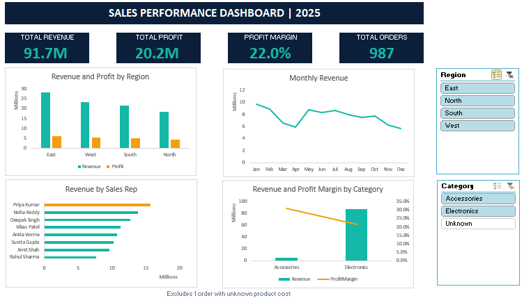

# Sales Performance Dashboard (Excel)

An interactive Excel dashboard built from a messy 2025 sales dataset, covering data cleaning, lookups, Pivot Tables, charts, KPI cards, and Slicers.

> **Note:** the data is **synthetic**, created for practice. It is not real company data.

## Business questions answered

1. Which region earns the most Revenue and Profit?
2. Which categories and products bring the most Profit?
3. How does Revenue change month by month?
4. Who are the top sales reps?
5. Where is the profit margin strongest?

## Key findings (full year, all 988 orders)

- **Total Revenue:** about 92.1M, **Total Profit:** about 20.6M, **Margin:** 22.4%
- **East** is the top region by Revenue and Profit; **North** is the lowest.
- **Electronics** gives about 94.5% of Revenue, but at a lower margin (21.6%) than **Accessories** (31.1%).
- The **Laptop** is the top product by Revenue and Profit.
- Revenue is highest in **January** and falls through the rest of the year, ending about 38% lower in December.
- **Priya Kumar** is the top sales rep (about 16.0M Revenue).

## Data cleaning (see the Cleaning_Log sheet)

| Column | Problem | Rows | Decision |
|---|---|---|---|
| OrderID | Duplicate rows | 15 | Removed (compared all columns, so only exact copies were deleted) |
| Region | Mixed case | 14 | Standardized with PROPER |
| Region | Extra spaces | 12 | Removed with TRIM |
| Customer | Blank cells | 9 | Filled with "Unknown" (the order still has real revenue) |
| Quantity | Blank cells | 12 | Rows deleted (Revenue cannot be calculated without Quantity) |
| ProductID | P199 not in the Products sheet | 1 | Row kept; UnitCost set to 0, so Profit for this order is overstated. Needs client confirmation. |

## How it was built

1. **Clean:** filters, TRIM, PROPER, Remove Duplicates, a Cleaning Log for every decision
2. **Prepare:** Excel Table (`tblOrders`), XLOOKUP for product name, category, and cost; calculated Revenue, Cost, Profit, and Month
3. **Analyze:** 5 Pivot Tables, including a Calculated Field for Profit Margin and a Show Values As rank
4. **Visualize:** column, line, bar, and combo chart with a secondary axis
5. **Dashboard:** KPI cards linked to a pivot with GETPIVOTDATA, plus Region and Category Slicers connected to every chart and card

## Design decision

The dashboard excludes the 1 order with unknown product cost (0.4% of Revenue), because its margin would show a false 100%. This is stated on the dashboard.

## Skills shown

Data cleaning, XLOOKUP, Excel Tables, Pivot Tables, Calculated Fields, GETPIVOTDATA, combo charts, Slicers, KPI cards, dashboard layout, and documenting decisions.

## Next steps

- Repeat the project on a larger, messier dataset using Power Query
- Add a monthly Revenue vs Target KPI
- Build a Power Pivot data model with DAX measures
